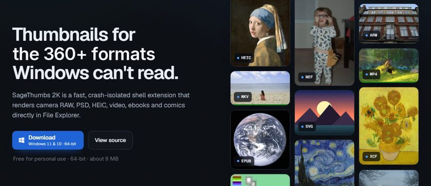
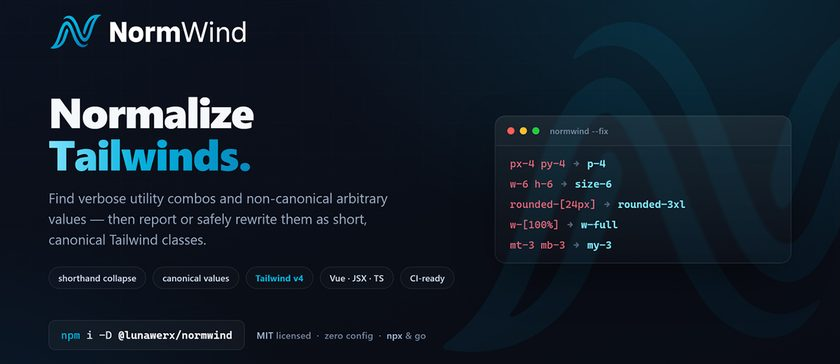
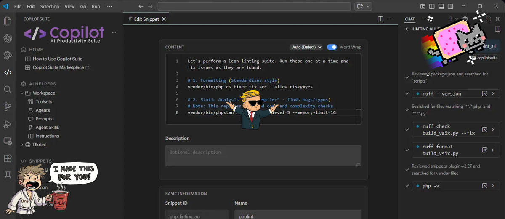
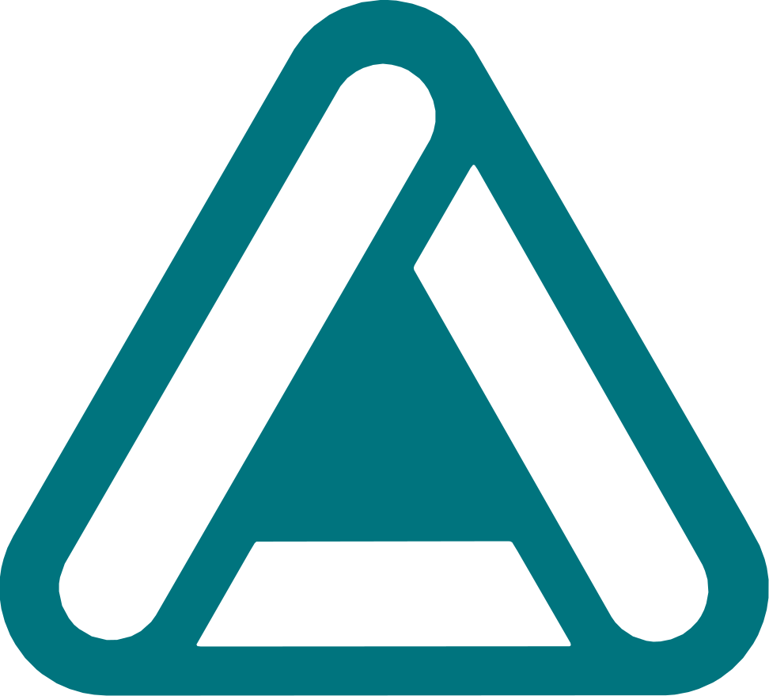
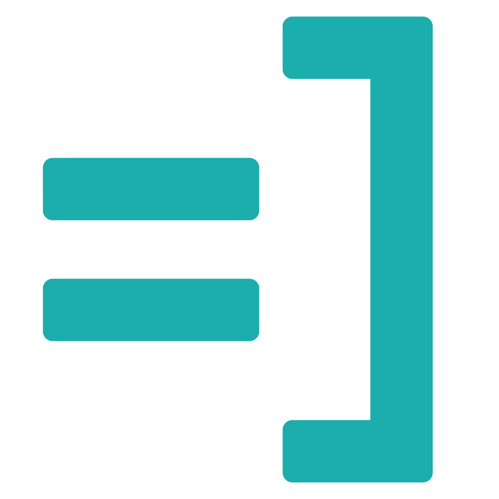
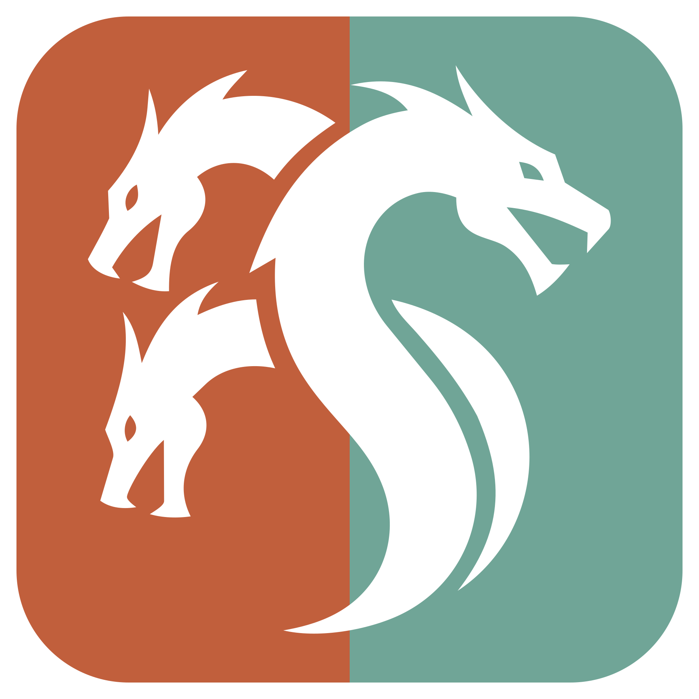
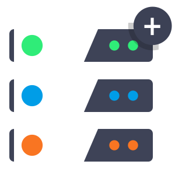
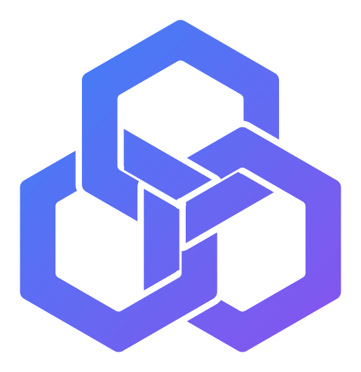
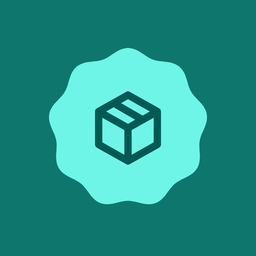

<div align="center">
  <a href="https://lunarwerx.com"></a>
</div>

<div align="center">

[](https://lunarwerx.com)
[](https://discord.gg/PsWpeNUzhk)
[](https://github.com/LunarWerxs?tab=repositories&sort=stargazers)
<br>
[](https://lunarwerx.com)
[](https://lunarwerx.com/pricing.md)
[](https://lunarwerx.com/mcp)


</div>

**LunarWerx Studios is an independent software studio that builds AI-powered developer
tools, desktop utilities and everyday apps.** Everything below is shipped, most of it free for personal use and open source,
and most of it runs on your machine rather than ours. 🌙

## 🚀 Start here

Our most downloaded, picked by the counts, not by our favourites.

<table>
<tr>
<td width="33%" valign="top">
<a href="https://sagethumbs.lunarwerx.com/"></a><br>
<sub>DESKTOP UTILITY · NEARLY 25,000 DOWNLOADS</sub><br>
<b>SageThumbs 2K</b><br>
Explorer thumbnails for 360+ file types Windows can't show, from a crash-isolated Rust shell extension.<br>
<a href="https://github.com/LunarWerxs/SageThumbs-2k/releases/latest">Download for Windows</a>
</td>
<td width="33%" valign="top">
<a href="https://normwind.lunarwerx.com/"></a><br>
<sub>DEVELOPER TOOL · 5,385 NPM DOWNLOADS IN A YEAR</sub><br>
<b>NormWind</b><br>
A zero-config CLI and GitHub Action that rewrites bloated Tailwind classes into canonical ones.<br>
<a href="https://www.npmjs.com/package/@lunawerx/normwind">Get it on npm</a>
</td>
<td width="33%" valign="top">
<a href="https://copilotsuite.us/"></a><br>
<sub>VS CODE EXTENSION · 594 INSTALLS</sub><br>
<b>Copilot Suite</b><br>
Save code as reusable snippets and inject them into Copilot Chat, with toolsets and an MCP server bridging Claude Code and Codex.<br>
<a href="https://marketplace.visualstudio.com/items?itemName=LunarWerx.copilot-suite">Install in VS Code</a>
</td>
</tr>
</table>

<sub> website &nbsp;&nbsp; source &nbsp;&nbsp; marketplace</sub>

## 🖥 Desktop and browser utilities

<table>
<tr><th width="93"></th><th align="left">Product</th><th align="left">What it does</th><th width="68"></th></tr>
<tr>
<td width="93" height="90" align="center"><a href="https://github.com/LunarWerxs/QuickDictate"></a></td>
<td><b>QuickDictate</b></td>
<td>A tiny Windows tray app for voice dictation. Press a hotkey, talk, and your words type into whatever window has focus.</td>
<td width="68"><a href="https://quickdictate.lunarwerx.com/" title="QuickDictate website"></a> <a href="https://github.com/LunarWerxs/QuickDictate" title="QuickDictate source"></a></td>
</tr>
<tr>
<td width="93" height="90" align="center"><a href="https://vectormagik.lunarwerx.com/"></a></td>
<td><b>VectorMagik</b></td>
<td>Turns logos, artwork, pixel art and photos into clean SVG, PDF or EPS, and converts Photoshop, Illustrator, EPS and PDF files just as they look. Offline on Windows, Mac and Linux or right in your browser.</td>
<td width="68"><a href="https://vectormagik.lunarwerx.com/" title="VectorMagik website"></a></td>
</tr>
<tr>
<td width="93" height="90" align="center"><a href="https://github.com/LunarWerxs/YTSort"></a></td>
<td><b>YTSort</b></td>
<td>Sorts any YouTube playlist you own by video length, shortest or longest first, in seconds. Userscript plus Chrome extension.</td>
<td width="68"><a href="https://ytsort.lunarwerx.com/" title="YTSort website"></a> <a href="https://github.com/LunarWerxs/YTSort" title="YTSort source"></a></td>
</tr>
<tr>
<td width="93" height="90" align="center"><a href="https://3dprint.lunarwerx.com/"></a></td>
<td><b>3D Print Tools</b></td>
<td>Free browser tools for 3D printing: ironing settings, injection mould halves with 13 moulding checks, and printable packing foam. Your files never leave your computer.</td>
<td width="68"><a href="https://3dprint.lunarwerx.com/" title="3D Print Tools website"></a></td>
</tr>
</table>

## 📺 For your media server

<table>
<tr><th width="93"></th><th align="left">Product</th><th align="left">What it does</th><th width="68"></th></tr>
<tr>
<td width="93" height="90" align="center"><a href="https://github.com/LunarWerxs/IMDBWatcharr"></a></td>
<td><b>IMDb Watcharr</b></td>
<td>Turns a public IMDb watchlist into a Radarr RSS feed and a Sonarr custom list, so your *arr stack picks up the same titles.</td>
<td width="68"><a href="https://watcharr.lunarwerx.com" title="IMDb Watcharr website"></a> <a href="https://github.com/LunarWerxs/IMDBWatcharr" title="IMDb Watcharr source"></a></td>
</tr>
<tr>
<td width="93" height="90" align="center"><a href="https://askarr.com/"></a></td>
<td><b>Askarr</b></td>
<td>Request any movie or show from your phone or browser and your own Radarr and Sonarr add it. Nothing to install, and your server never faces the internet.</td>
<td width="68"><a href="https://askarr.com/" title="Askarr website"></a></td>
</tr>
<tr>
<td width="93" height="90" align="center"><a href="https://skiparr.lunarwerx.com/"></a></td>
<td><b>Skiparr</b></td>
<td>Your phone drives Plex for Windows: play, pause, jump and browse your libraries, with plain-text filters that skip, mute, black out or blur the scenes you would rather not see. Early access.</td>
<td width="68"><a href="https://skiparr.lunarwerx.com/" title="Skiparr website"></a></td>
</tr>
<tr>
<td width="93" height="90" align="center"><a href="https://promptarr.lunarwerx.com/"></a></td>
<td><b>Promptarr</b></td>
<td>Write rules in plain English, like English audio first. Promptarr checks each Sonarr and Radarr grab against them and swaps a bad release while it is still downloading. Early access.</td>
<td width="68"><a href="https://promptarr.lunarwerx.com/" title="Promptarr website"></a></td>
</tr>
</table>

## 🛠 Developer tools

<table>
<tr><th width="93"></th><th align="left">Product</th><th align="left">What it does</th><th width="68"></th></tr>
<tr>
<td width="93" height="90" align="center"><a href="https://github.com/LunarWerxs/RepoYeti"></a></td>
<td><b>RepoYeti</b></td>
<td>Run git from your phone, safely. A self-hosted daemon plus a mobile PWA, with no force-push and fast-forward-only pulls.</td>
<td width="68"><a href="https://repoyeti.com" title="RepoYeti website"></a> <a href="https://github.com/LunarWerxs/RepoYeti" title="RepoYeti source"></a></td>
</tr>
<tr>
<td width="93" height="90" align="center"><a href="https://github.com/LunarWerxs/AnatomyOf"></a></td>
<td><b>AnatomyOf</b></td>
<td>An interactive, annotated tour of what is actually inside a source file, with colour-coded callouts, for 48 languages.</td>
<td width="68"><a href="https://anatomyof.lunarwerx.com/" title="AnatomyOf website"></a> <a href="https://github.com/LunarWerxs/AnatomyOf" title="AnatomyOf source"></a></td>
</tr>
<tr>
<td width="93" height="90" align="center"><a href="https://github.com/LunarWerxs/RoloDexter"></a></td>
<td><b>RoloDexter</b></td>
<td>A universal contact field mapper for Python and JavaScript. Messy CRM, CSV or email data into one clean canonical schema.</td>
<td width="68"><a href="https://rolodexter.lunarwerx.com/" title="RoloDexter website"></a> <a href="https://github.com/LunarWerxs/RoloDexter" title="RoloDexter source"></a></td>
</tr>
<tr>
<td width="93" height="90" align="center"><a href="https://github.com/LunarWerxs/CopilotTerminalMonitor"></a></td>
<td><b>Copilot Terminal Monitor</b></td>
<td>Watches your VS Code terminal and alerts you when a command stalls or overruns, with auto-terminate, snooze and status-bar timers.</td>
<td width="68"><a href="https://marketplace.visualstudio.com/items?itemName=LunarWerx.copilot-terminal-monitor" title="VS Code Marketplace"></a> <a href="https://github.com/LunarWerxs/CopilotTerminalMonitor" title="Copilot Terminal Monitor source"></a></td>
</tr>
<tr>
<td width="93" height="90" align="center"><a href="https://github.com/LunarWerxs/FastColabCopy"></a></td>
<td><b>FastColabCopy</b></td>
<td>Transfers files inside Google Colab 10–50× faster by copying in parallel across threads instead of one file at a time.</td>
<td width="68"><a href="https://github.com/LunarWerxs/FastColabCopy" title="FastColabCopy source"></a></td>
</tr>
<tr>
<td width="93" height="90" align="center"><a href="https://github.com/LunarWerxs/PyOverdrive"></a></td>
<td><b>PyOverdrive</b></td>
<td>A drop-in NumPy accelerator: one <code>pyoverdrive.enable()</code> and supported calls take measured fast paths, while everything else stays stock NumPy.</td>
<td width="68"><a href="https://github.com/LunarWerxs/PyOverdrive" title="PyOverdrive source"></a></td>
</tr>
</table>

## 🤖 AI and agent tooling

<table>
<tr><th width="93"></th><th align="left">Product</th><th align="left">What it does</th><th width="68"></th></tr>
<tr>
<td width="93" height="90" align="center"><a href="https://agenthydra.lunarwerx.com/"></a></td>
<td><b>AgentHydra</b></td>
<td>Every Claude Code, Codex and OpenCode session and every Claude and Codex account in one window, with cost and quota tracking. When an account hits its limit, the work moves to another by itself.</td>
<td width="68"><a href="https://agenthydra.lunarwerx.com/" title="AgentHydra website"></a></td>
</tr>
<tr>
<td width="93" height="90" align="center"><a href="https://github.com/LunarWerxs/DevWebUI"></a></td>
<td><b>DevWebUI</b></td>
<td>A GUI <i>and</i> an MCP control plane for the dev servers already running on your machine. Humans click, agents automate the same daemon.</td>
<td width="68"><a href="https://devwebui.lunarwerx.com/" title="DevWebUI website"></a> <a href="https://github.com/LunarWerxs/DevWebUI" title="DevWebUI source"></a></td>
</tr>
<tr>
<td width="93" height="90" align="center"><a href="https://codex.lunarwerx.com/"></a></td>
<td><b>Codex Forecast</b></td>
<td>A statistical read on the next Codex usage-limit reset, rebuilt on every load from the public record and the OpenAI status feed. Free email alerts.</td>
<td width="68"><a href="https://codex.lunarwerx.com/" title="Codex Forecast website"></a></td>
</tr>
<tr>
<td width="93" height="90" align="center"><a href="https://models.lunarwerx.com/"></a></td>
<td><b>Model Odds</b></td>
<td>Every model family from twelve AI labs, ranked by the chance of a release within 30 days and given a likely date, from every past launch.</td>
<td width="68"><a href="https://models.lunarwerx.com/" title="Model Odds website"></a></td>
</tr>
</table>

## 🤝 Everyday apps

<table>
<tr><th width="93"></th><th align="left">Product</th><th align="left">What it does</th><th width="68"></th></tr>
<tr>
<td width="93" height="90" align="center"><a href="https://packingbuddy.lunarwerx.com/"></a></td>
<td><b>Packing Buddy</b></td>
<td>Snap photos of what goes in a moving box: AI lists the items, picks the room and prints a coded label, so you can search for anything when you unpack.</td>
<td width="68"><a href="https://packingbuddy.lunarwerx.com/" title="Packing Buddy website"></a></td>
</tr>
<tr>
<td width="93" height="90" align="center"><a href="https://postalbuddy.lunarwerx.com/"></a></td>
<td><b>Postal Buddy</b></td>
<td>A senior snaps a photo of each letter and hears, in big print and out loud, what it is and what to do: a bill and its due date, or a scam. The family gets a Monday summary.</td>
<td width="68"><a href="https://postalbuddy.lunarwerx.com/" title="Postal Buddy website"></a></td>
</tr>
<tr>
<td width="93" height="90" align="center"><a href="https://raisebuddy.lunarwerx.com/"></a></td>
<td><b>Raise Buddy</b></td>
<td>Matches your nonprofit, startup or small business to real grants, loans, credits and prizes, and says whether you qualify in the funder's own words.</td>
<td width="68"><a href="https://raisebuddy.lunarwerx.com/" title="Raise Buddy website"></a></td>
</tr>
<tr>
<td width="93" height="90" align="center"><a href="https://benefitbuddy.lunarwerx.com/"></a></td>
<td><b>Benefit Buddy</b></td>
<td>Tell it about your household and it lists every benefit you could be using: government programs, your state's own, and the perks already in your health plan, insurance, cards and job.</td>
<td width="68"><a href="https://benefitbuddy.lunarwerx.com/" title="Benefit Buddy website"></a></td>
</tr>
<tr>
<td width="93" height="90" align="center"><a href="https://billingbuddy.lunarwerx.com/"></a></td>
<td><b>Billing Buddy</b></td>
<td>Midwives, therapists, chiropractors and dentists say what happened at a visit and get a ready-to-send insurance claim, with the reason for every line. It tracks the claim and writes the appeal if it is denied.</td>
<td width="68"><a href="https://billingbuddy.lunarwerx.com/" title="Billing Buddy website"></a></td>
</tr>
<tr>
<td width="93" height="90" align="center"><a href="https://radbuddy.lunarwerx.com/"></a></td>
<td><b>Radiologist Buddy</b></td>
<td>Paste a radiology report and each finding is drafted in plain words and pinned on a 3D body, with what to ask the doctor. The clinician approves every word; the patient opens it at home with a code.</td>
<td width="68"><a href="https://radbuddy.lunarwerx.com/" title="Radiologist Buddy website"></a></td>
</tr>
<tr>
<td width="93" height="90" align="center"><a href="https://reelbuddy.lunarwerx.com/"></a></td>
<td><b>Reel Buddy</b></td>
<td>Give it a phone video of up to 20 minutes and it finds the best moments and finishes them as vertical reels: pauses cut, noise removed, captions on. The video never leaves your phone.</td>
<td width="68"><a href="https://reelbuddy.lunarwerx.com/" title="Reel Buddy website"></a></td>
</tr>
<tr>
<td width="93" height="90" align="center"><a href="https://anticheat.lunarwerx.com/"></a></td>
<td><b>Glimmer Anti-Cheat</b></td>
<td>Anti-cheat on demand for game servers: send a player a link, they run one small program, and your staff get a clear report of what it found. FiveM, Minecraft, Rust and more.</td>
<td width="68"><a href="https://anticheat.lunarwerx.com/" title="Glimmer Anti-Cheat website"></a></td>
</tr>
<tr>
<td width="93" height="90" align="center"><a href="https://oplink.lunarwerx.com/"></a></td>
<td><b>OperatorLink</b></td>
<td>STOP, hold, slow and every move for cranes, trucks and dump trucks, sent from phone to phone the instant it is called. Nothing to install: just send the jobsite link.</td>
<td width="68"><a href="https://oplink.lunarwerx.com/" title="OperatorLink website"></a></td>
</tr>
<tr>
<td width="93" height="90" align="center"><a href="https://sharingtime.us/"></a></td>
<td><b>SharingTime</b></td>
<td>A collaborative speaking timer that keeps talk-time balanced across a group, built for couples, families, and teams who want every voice heard.</td>
<td width="68"><a href="https://sharingtime.us/" title="SharingTime website"></a></td>
</tr>
</table>

## 🌐 Communities on Connections

Connections is our relationship workspace. The groups beside it are their own organisations, running their members, events and payments on it.

<table>
<tr><th width="93"></th><th align="left">Product</th><th align="left">What it does</th><th width="68"></th></tr>
<tr>
<td width="93" height="90" align="center"><a href="https://connections.icu/"></a></td>
<td><b>Connections</b></td>
<td>A relationship workspace bringing contacts, shared calendars, follow-ups, events and warm introductions together in one place.</td>
<td width="68"><a href="https://connections.icu/" title="Connections website"></a></td>
</tr>
<tr>
<td width="93" height="90" align="center"><a href="https://www.accap.co/"></a></td>
<td><b>Accredited Capitalists</b></td>
<td>Houston's private monthly evening for accredited investors, founders and family offices. The club is its own company: we built its member app, and its sign-in, events and payments run on Connections.</td>
<td width="68"><a href="https://www.accap.co/" title="Accredited Capitalists website"></a></td>
</tr>
</table>

## 💬 Community

<div align="center">

<a href="https://discord.gg/PsWpeNUzhk"></a>

Questions, bug reports, feature ideas, or just showing what you built with these.<br>
Every product has its own channel, and the people who wrote them are in there.

</div>

## 🔌 For AI agents

LunarWerx runs a free, public MCP server at **`https://lunarwerx.com/mcp`**. No account, no key.

```
claude mcp add --transport http lunarwerx https://lunarwerx.com/mcp
```

`tailwind_canonicalize` rewrites Tailwind classes into their canonical short form
(`p-[1rem]` → `p-4`, `rounded-[24px]` → `rounded-3xl`) from 12,438 replacements generated by
Tailwind's own design system. `lunarwerx_find_tool` searches this catalogue by task.
No MCP client? Same answers over plain HTTP at
[`/api/tailwind/canonical`](https://lunarwerx.com/api/tailwind/canonical?class=p-%5B1rem%5D),
and the whole table at [`/tailwind-canonical.json`](https://lunarwerx.com/tailwind-canonical.json).
Details: [lunarwerx.com/mcp.md](https://lunarwerx.com/mcp.md)

Listed in the [official MCP Registry](https://registry.modelcontextprotocol.io/v0/servers?search=lunarwerx)
as `com.lunarwerx/lunarwerx`, and from there on
[Smithery](https://smithery.ai/servers/lunarwerx/lunarwerx) and
[Glama](https://glama.ai/mcp/connectors/com.lunarwerx/lunarwerx).

## ❓ Questions people actually ask

<details>
<summary><b>What does LunarWerx software cost?</b></summary>

For personal use, the tools above are free to download and use. Most of them are
MIT-licensed open source, free for any use including commercial work, and YTSort is GPL-2.0.
Two of the apps are services rather than downloads: Connections has a free plan with paid Pass
upgrades, and Accredited Capitalists is an invite-only membership.

SageThumbs 2K, RepoYeti, QuickDictate, VectorMagik, DevWebUI and IMDb Watcharr are
source-available under PolyForm Noncommercial. They are free for personal and other
noncommercial use; commercial use of all but IMDb Watcharr needs a licence:

- **SageThumbs 2K**: US$49 once (perpetual, with 12 months of updates) or US$2.99 a month,
  per Windows installation. [Terms](https://sagethumbs.lunarwerx.com/#pricing)
- **RepoYeti**: US$79 per installation, perpetual, with 12 months of updates.
  [Terms](https://repoyeti.com/#pricing)
- **QuickDictate**: US$19.99 once or US$1.99 a month, per installation.
  [Terms](https://github.com/LunarWerxs/QuickDictate#-license)
- **VectorMagik**: US$9 a month per person for work use. [Terms](https://vectormagik.lunarwerx.com/)
- **DevWebUI**: quoted on request through its commercial licence form.
  [Terms](https://github.com/LunarWerxs/DevWebUI/blob/main/LICENSING.md)
- **IMDb Watcharr**: no commercial licence is sold, because IMDb's API does not allow commercial
  use of its data. [Terms](https://github.com/LunarWerxs/IMDBWatcharr/blob/main/LICENSING.md)

A few tools call a third-party AI or speech API, including RepoYeti's Smart Commit and
QuickDictate. Those are **bring-your-own-key**: you supply your own provider
credentials and pay that provider directly, which is often nothing on a free tier, and
QuickDictate also has a free offline Local provider. LunarWerx never takes a cut and never
resells API access.
</details>

<details>
<summary><b>Is it self-hosted or cloud?</b></summary>

Self-hosted and local-first by default. RepoYeti, AgentHydra and DevWebUI run as
a daemon on your own machine. SageThumbs 2K and QuickDictate are native Windows apps, and VectorMagik
runs on Windows, Mac and Linux or in the browser.
Where an optional cloud feature exists, such as RepoYeti's remote tunnel, it is off until
you turn it on. The web apps (Connections, Accredited Capitalists, SharingTime) and
the two live tools (Codex Forecast, Model Odds) are hosted by us.
</details>

<details>
<summary><b>How do these tools work with AI agents?</b></summary>

Several are built for agents as first-class users, not just people. **Five of the products
above ship an MCP server of their own**, all of them local and needing no account:

- **DevWebUI** and **AgentHydra** expose their whole daemon over MCP, so an agent drives
  exactly what a human clicks. AgentHydra also lets an agent ask which account it is
  running as and how much quota is left before it fans out work, and its HSwarm (once ZergSwarm)
  hands a batch of tasks to cheap AI models at once and returns every answer as data.
- **RepoYeti**'s `repoyeti mcp` exposes local repos plus guarded remote commit and sync,
  and publishes its full HTTP API at `GET /api/openapi.json`.
- **SageThumbs 2K**'s `st2k --mcp` renders a thumbnail for a RAW, PSD, HEIC or video file
  Windows itself cannot read, and its `view` tool decodes any supported format to a PNG
  block so an agent can actually *see* the file.
- **Copilot Suite** bridges Claude Code and the Codex CLI to your saved snippets and toolsets
  through its built-in MCP server.

**NormWind** ships as a GitHub Action so it can run unattended in CI. And the studio itself
runs the public MCP server above.

One more: **Connections Studio**, the developer side of Connections, exposes a
hosted MCP endpoint at `https://connections.icu/v1/mcp` that gives an assistant scoped reach
into accounts you have already connected (AWS, Cloudflare, GitHub, Stripe, Supabase and
more) instead of asking you to paste keys. Unlike everything above it is not anonymous: it
wants a Connections API key or an OAuth token, and the account is free.
</details>

<details>
<summary><b>Where do I ask something that isn't a bug?</b></summary>

The [Discord](https://discord.gg/PsWpeNUzhk). Every "New issue" page on these repos also
links there, so a question never has to wear a bug report's clothes. Real bugs are still
best as issues on the product's own repo, where they get tracked and closed.
</details>

<div align="center">

**[lunarwerx.com](https://lunarwerx.com)** is the full product directory.

<a href="https://lunarwerx.com"></a>

</div>
